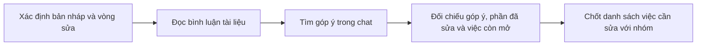
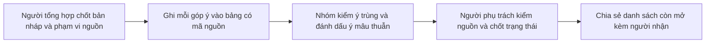

# Báo cáo nhóm — Day 02 Discovery & Problem Framing

> Bản lưu sau lab của AIS. Báo cáo ghi lại đề tài đã chuẩn bị, tài liệu tham khảo và phương án được phân tích. Các quy trình, mức rủi ro và mục tiêu dưới đây là đề xuất. Trạng thái kiểm chứng được ghi riêng theo từng checkpoint.

## 1. Thông tin nhóm

- Tên nhóm — AIS. Thành viên và phân công xem [TEAM.md](../../TEAM.md).
- **Candidate đề xuất** — Khi sửa một bản nháp đã nhận góp ý qua chat và bình luận tài liệu, thành viên tổng hợp phải đối chiếu hai nguồn để biết góp ý nào còn cần xử lý.
- **Phạm vi** — Một bài nhóm, một bản nháp, một vòng góp ý nội bộ. Đầu ra cần chốt là danh sách việc còn mở và người chịu trách nhiệm, trước khi bắt đầu vòng sửa. Việc sửa nội dung bài nằm ngoài phạm vi đo thời gian.
- **Quyết định đề xuất — Not Yet.** Hồ sơ chưa có bằng chứng về một vòng sửa thực tế để chốt việc thử bảng theo dõi thủ công.

## 2. Hội tụ nhóm (CP3)

### 2.1. Danh sách chuẩn bị pitch

Bảng dưới đây tổng hợp 12 card đã chuẩn bị trong bốn file cá nhân. Hồ sơ chưa có biên bản xác nhận những card đã được trình bày, câu hỏi phản biện, kết quả gom nhóm hoặc điểm shortlist.

| Mã | Người dự kiến pitch | Vấn đề dự kiến | Actor và bước nghẽn giả định |
|---|---|---|---|
| C1 | TV01 | Góp ý còn mở ở nhiều kênh | Người tổng hợp đối chiếu góp ý và trạng thái giữa chat và tài liệu. |
| C2 | TV01 | Tìm bản mới nhất trước khi sửa | Người chỉnh bài đối chiếu và xác nhận link bản chính. |
| C3 | TV01 | Xác nhận người phụ trách sau buổi họp | Người điều phối xác nhận ai nhận các việc còn mơ hồ. |
| C4 | TV02 | Chốt lịch họp nhóm qua nhiều lượt nhắn | Người điều phối đối chiếu giờ rảnh và hỏi lại câu trả lời mơ hồ. |
| C5 | TV02 | Phát hiện hai người nhận phần việc chồng nhau | Người chia việc đối chiếu các phần có cùng đầu ra. |
| C6 | TV02 | Tìm lại căn cứ khi nhóm chọn phương án | Thành viên cần giải thích quyết định dò lý do và phương án đã cân nhắc. |
| C7 | TV03 | Gắn nhận định tổng hợp với đúng ghi chú nguồn | Người tổng hợp đối chiếu nhận định với câu hoặc mốc thời gian trong nguồn. |
| C8 | TV03 | Ẩn thông tin nhận diện trong ảnh minh chứng | Người chuẩn bị ảnh rà các vùng có tên hoặc dữ liệu riêng. |
| C9 | TV03 | Làm rõ một câu trả lời quá chung | Người hỏi cần làm rõ bước cụ thể và hệ quả của sự việc. |
| C10 | TV04 | Xác định một tính năng dùng được với tài khoản nhóm | Người tìm công cụ đối chiếu điều kiện tài khoản và quyền nhóm. |
| C11 | TV04 | Truy lại nguồn của một claim trong báo cáo | Người kiểm nguồn đối chiếu nội dung tài liệu với phạm vi nhận định. |
| C12 | TV04 | So sánh hai cách làm theo cùng tiêu chí | Người tổng hợp đưa các phép đo về cùng đơn vị và ngữ cảnh. |


#### Câu hỏi đã chuẩn bị để pitch

Các câu hỏi được tổng hợp từ bốn báo cáo cá nhân. Nhóm bổ sung câu hỏi đã trao đổi và phản hồi thực tế vào biên bản pitch khi xác nhận.

| Người chuẩn bị | Card | Câu hỏi trọng tâm |
|---|---|---|
| TV01 | C1 | Phần tốn công nhất là tìm đủ nguồn, hiểu yêu cầu hay xác nhận góp ý đã được xử lý? |
| TV02 | C4 | Tốn công ở lúc đối chiếu giờ hay ở lúc chờ phản hồi? |
| TV03 | C7 | Bước nghẽn là tìm ghi chú hay kiểm xem ghi chú hỗ trợ kết luận đến đâu? |
| TV04 | C10 | Vướng ở việc đọc tài liệu hay ở việc chưa biết quyền của tài khoản nhóm? |

#### Gom cụm theo khó khăn

| Cụm | Ứng viên | Điểm chung |
|---|---|---|
| Đối chiếu nguồn và trạng thái | C1, C2, C6, C7, C11 | Cần tìm đúng bản, nguồn hoặc căn cứ để xác nhận một thông tin. |
| Điều phối người và đầu việc | C3, C4, C5 | Thông tin về người nhận, thời gian hoặc phạm vi công việc nằm rải rác. |
| Kiểm điều kiện trước khi dùng kết quả | C8, C9, C10, C12 | Cần làm rõ quyền, dữ liệu còn thiếu hoặc điều kiện để so sánh và sử dụng. |

### 2.2. Cây Opportunity Solution Tree dự kiến cho C1

Cây này ghi lại các khó khăn cần kiểm chứng cho đề xuất C1.

```text
Outcome: Giảm thời gian chốt danh sách góp ý còn mở cho một vòng sửa
├── Góp ý cho cùng một đoạn nằm ở nhiều nguồn
├── Khó biết hai góp ý đang nói về cùng một thay đổi hay yêu cầu khác nhau
└── Khó xác nhận góp ý nào đã được xử lý hoặc đang chờ quyết định
```

### 2.3. Shortlist và lựa chọn

Bảng chấm dự thảo theo thang 1–5, dựa trên 12 card đang có. Điểm bằng chứng là 1 ở cả ba ứng viên vì chưa có ca người dùng được xác nhận.

| Ứng viên | Actor rõ | Quy trình rõ | Pain có bằng chứng | Impact đo được | Vừa sức lab | So sánh được 4 mức | Nhóm hiểu domain | Tổng |
|---|---:|---:|---:|---:|---:|---:|---:|---:|
| C1 · Góp ý còn mở | 5 | 5 | 1 | 5 | 5 | 5 | 5 | **31** |
| C2 · Tìm đúng bản mới nhất | 5 | 5 | 1 | 4 | 5 | 3 | 5 | **28** |
| C4 · Chốt lịch họp | 5 | 4 | 1 | 4 | 4 | 3 | 5 | **26** |

- **Ưu tiên C1.** Có đầu ra kiểm được là danh sách góp ý còn mở và người nhận. Có thể đo thời gian, kiểm bỏ sót và so các mức can thiệp trong phạm vi một vòng sửa.
- **Tạm loại C2.** Một link bản chính được ghim có thể xử lý phần lớn vấn đề. Giá trị còn lại phụ thuộc số lần nhóm thực sự mở nhầm bản.
- **Tạm loại C4.** Thời gian chờ mọi người phản hồi dễ lấn át thao tác tổng hợp. Cần thêm các lượt hẹn thật để tách hai phần thời gian trước khi đánh giá.

Lựa chọn C1 dựa trên đánh giá hồ sơ. Kết quả biểu quyết và phản biện trực tiếp cần nhóm xác nhận.

## 3. Kiểm chứng và research (CP4)

### 3.1. Assumption Map

Điểm quan trọng từ 1–5 thể hiện thứ tự ưu tiên đề xuất. Trạng thái bằng chứng dựa trên tài liệu hiện có.

| # | Giả định cần kiểm | Loại | Quan trọng | Bằng chứng hiện có | Kiểm thế nào |
|---|---|---|---:|---|---|
| A1 | Một vòng sửa thật có góp ý cần xử lý nằm ở cả chat lẫn bình luận tài liệu. | Value | 5 | Chưa có | Xin kể lại một vòng gần nhất, chỉ ra nguồn của từng góp ý đã làm. |
| A2 | Đối chiếu góp ý và trạng thái làm mất công hơn chỉ mở tài liệu hoặc đọc một chuỗi chat. | Value | 5 | Chưa có | Tách thời gian từng bước bằng một lượt tái hiện nếu người tham gia đồng ý. |
| A3 | Góp ý bị bỏ sót, ghi trùng hoặc cần hỏi lại vì trạng thái thiếu rõ ràng. | Value | 4 | Chưa có | Hỏi một ví dụ đã xảy ra và hậu quả cụ thể. Ghi cả trường hợp nhóm xử lý tốt. |
| A4 | Người sửa có quyền xem cả hai nguồn và xác định đoạn đang được góp ý. | Feasibility | 4 | Chưa có | Kiểm tra quyền và cách xác định phiên bản trong một vòng sửa thật. |
| A5 | Nhóm có người chốt việc và duy trì trạng thái góp ý. | Usability / Viability | 4 | Chưa có | Hỏi ai thực sự đã tổng hợp, họ cập nhật ở đâu và khi nào. |

### 3.2. Trạng thái kiểm chứng

**Rà hồ sơ.** Có bốn báo cáo cá nhân, 12 card và deck pitch. Mục tài sản của repo chưa có ghi chú phỏng vấn, khảo sát hoặc bản ghi đủ hai nguồn từ một vòng sửa thật. Bằng chứng hiện có dùng để xác định câu hỏi và thiết kế phép đo.

**Cách thu thập.** Hỏi 2–3 người ngoài nhóm từng tổng hợp góp ý. Yêu cầu kể một vòng sửa gần nhất và ghi lại các bước, ưu tiên một trường hợp góp ý chỉ nằm ở một nơi để có tín hiệu phản bác.

1. Lần gần nhất bạn gom góp ý cho một bản nháp là khi nào? Bạn mở nguồn nào và làm theo thứ tự nào?
2. Có việc nào cần dò lại, bị gộp nhầm hoặc thiếu người nhận? Chuyện gì xảy ra sau đó?
3. Bước nào mất nhiều công nhất? Nếu có thể tái hiện, bấm giờ từng bước và ghi riêng phần ước lượng.
4. Có vòng sửa nào bạn chỉ dùng bình luận trên tài liệu là đủ? Điều kiện nào giúp cách đó hiệu quả?

| Mã ẩn danh | Vai trò, ngày và cách thu thập | Vòng sửa và nguồn thực tế | Bước nghẽn, thời gian, hệ quả | Tín hiệu ủng hộ / phản bác |
|---|---|---|---|---|
| P01 | | | | |
| P02 | | | | |
| P03 nếu có | | | | |

**Điều chỉnh cần xem sau CP4.** Nếu nhóm thường tập trung góp ý trong tài liệu và ít bỏ sót, thu hẹp đối tượng về các vòng sửa có góp ý quan trọng ở cả hai nguồn. Nếu công sức chủ yếu nằm ở tìm link bản nháp, xem lại thứ hạng của C2. Hiện chưa có dữ liệu người tham gia để kết luận các thay đổi đó.

### 3.3. Các cách làm đã có

| Cách làm | Bước giải được | Khoảng trống với candidate | Bài học | Nguồn |
|---|---|---|---|---|
| Bình luận và action item trong Google Docs | Gắn góp ý vào đoạn văn, giao việc trên tài khoản đủ điều kiện và đánh dấu đã xử lý. | Góp ý phát sinh trong chat vẫn cần được đưa vào quy trình. | Nếu nhóm có thể chuyển toàn bộ nhận xét về một tài liệu, dùng tính năng có sẵn trước. | [Google Docs Editors Help](https://support.google.com/docs/answer/65129) |
| Review trên GitHub pull request | Gắn nhận xét vào phần thay đổi và phân biệt hội thoại còn mở với hội thoại đã giải quyết. | Nhóm phải đưa bản nháp lên GitHub và gom góp ý ngoài PR vào cùng một luồng. | Giữ tham chiếu tới đoạn gốc và cho người có trách nhiệm xác nhận đã xử lý. | [GitHub Docs về bình luận và xử lý hội thoại](https://docs.github.com/en/pull-requests/how-tos/review-pull-requests/commenting-on-a-pull-request#resolving-conversations) |
| Task list Markdown | Ghi và đánh dấu một danh sách đầu việc chung. | Nhóm tự bổ sung người nhận, mã nguồn, trạng thái chờ chốt và đối chiếu trùng. | Có thể thử một bảng hoặc checklist trong công cụ đang dùng trước khi thêm tự động hóa. | [GitHub Docs về task list](https://docs.github.com/en/get-started/writing-on-github/getting-started-with-writing-and-formatting-on-github/basic-writing-and-formatting-syntax#task-lists) |

Từ tài liệu sản phẩm, có thể thử dùng trạng thái có sẵn nếu góp ý đã nằm ở một nơi. Mức phù hợp với AIS còn phụ thuộc vào việc các nhận xét thực tế nằm ở một nguồn hay nhiều nguồn.

## 4. Quy trình trước/sau (CP5)

### 4.1. Quy trình hiện tại cần kiểm chứng



| Bước | Actor | Input | Output | Thời gian/vòng |
|---|---|---|---|---|
| 1. Xác định phạm vi | Người tổng hợp | Link bản nháp và mốc nhận góp ý | Phiên bản và khoảng thời gian cần rà | Chưa có số đo. Minh họa 2 phút. |
| 2. Đọc bình luận | Người tổng hợp | Bình luận trên tài liệu | Tập góp ý gắn với đoạn văn | Chưa có số đo. Minh họa 4 phút. |
| 3. Tìm trong chat | Người tổng hợp | Đoạn chat trong vòng sửa | Tập góp ý từ chat | Chưa có số đo. Minh họa 5 phút. |
| 4. Đối chiếu hai nguồn | Người tổng hợp | Hai tập góp ý và bản nháp | Góp ý còn mở, đã xử lý, trùng hoặc cần chốt | Chưa có số đo. Minh họa 11 phút. Đây là bước nghẽn dự kiến. |
| 5. Xác nhận danh sách | Người tổng hợp và người phụ trách nội dung | Danh sách dự kiến | Danh sách được xác nhận và phân người xử lý | Chưa có số đo. Minh họa 2 phút. |

Tổng thời gian minh họa là 24 phút theo [Card 1 của TV01](../individual/2A202604032_TranVanQuang.md). Cột trên mô tả cách ghi theo từng bước, còn baseline thực tế chờ một vòng sửa được bấm giờ.

### 4.2. Tương lai đề xuất — bảng thủ công dùng chung



Bảng theo dõi đề xuất gồm mã góp ý, mục trên bản nháp, nội dung, nguồn, người xử lý, trạng thái và căn cứ chốt.

Người phụ trách nội dung kiểm hai nguồn trước khi chốt. Chỉ gộp góp ý nếu chúng yêu cầu cùng một thay đổi và giữ cả hai mã nguồn. Ý mâu thuẫn mang trạng thái **Chờ chốt** cho đến khi người có trách nhiệm quyết định. Nếu thiếu nguồn, sai phiên bản hoặc bảng không cập nhật được, quay về đọc hai nguồn và xác nhận với người góp ý.

### 4.3. Before / after

| Chỉ số | Hiện tại | Kỳ vọng khi thử | Cách ghi |
|---|---|---|---|
| Số bước và bước thủ công | 5/5 theo sơ đồ giả định | 5/5 theo sơ đồ đề xuất | Xác nhận lại bước thật sau CP4. |
| Phút lập và chốt danh sách | Baseline B chờ đo. Ví dụ 24 phút. | ≤ 0,75 × B, tương ứng tối đa 18 phút trong ví dụ | Với cả hai cách, bấm giờ từ lúc bắt đầu xác định phạm vi đến khi danh sách được xác nhận. Tính cả thời gian lập và rà bảng. Tách riêng thời gian sửa nội dung. Ghi riêng số đo và số ước lượng. |
| Góp ý còn mở bị sót | Chưa có số mục đã kiểm | 0 góp ý quan trọng bị sót | Một người thứ hai đối chiếu danh sách với hai nguồn. Định nghĩa góp ý quan trọng trước khi thử, ví dụ liên quan tiêu chí bắt buộc của bài. |
| Rủi ro | Trạng thái chưa rõ hoặc ý trùng | Bảng lỗi thời hoặc gộp nhầm | Giữ mã nguồn và kiểm trước khi chốt. |

## 5. Problem Statement v0 (CP5)

V0 ghi lại cách xác định vấn đề ở giai đoạn chuẩn bị. Actor, quy trình và bước nghẽn vẫn cần bằng chứng để xác nhận.

| Trường | Điểm cần chốt |
|---|---|
| **Actor** | Thành viên dự kiến là người tổng hợp góp ý cho một vòng sửa. |
| **Quy trình** | Mở đúng bản nháp, đọc hai nguồn, đối chiếu và chốt danh sách góp ý còn mở. |
| **Bottleneck** | Nghi vấn là bước đối chiếu cùng một góp ý giữa hai nguồn để xác định trạng thái. Chưa có số phút cho từng bước. |
| **Impact** | Rủi ro được đề xuất gồm hỏi lại, sửa trùng hoặc bỏ sót góp ý. Hồ sơ chưa có hệ quả đã quan sát. |
| **Success Metric** | Trung vị số phút để lập và chốt danh sách góp ý còn mở. Baseline B chưa xác định. Mục tiêu thử là ≤ 0,75 × B. Dùng mốc bắt đầu và kết thúc ở mục 4.3, đồng thời ghi số góp ý quan trọng bị sót. |
| **Boundary** | Người phụ trách nội dung chốt trạng thái. Ý mâu thuẫn hoặc thiếu nguồn cần xác nhận trước khi đóng. Dữ liệu riêng chỉ dùng trong phạm vi được phép. |

**Câu hỏi phản biện đã chuẩn bị** — Nếu góp ý đã được chốt ngay trong tài liệu thì bước nào còn đáng cải thiện? Nếu bảng làm việc nhanh hơn nhưng gộp nhầm hai ý khác nhau, tiêu chí nào phát hiện lỗi?

## 6. Mức can thiệp (CP6)

**Ô ma trận dự kiến — mơ hồ cao × phức tạp thấp.** Cách hiểu góp ý có thể khác nhau khi người góp ý diễn đạt mơ hồ hoặc đưa ra yêu cầu mâu thuẫn. Phạm vi xử lý giới hạn một bản nháp, hai nguồn và một vòng sửa, với các bước có thể định trước. Nếu CP4 cho thấy hầu hết góp ý đã có đầu việc và mã mục rõ, chuyển sang ô mơ hồ thấp.

| Mức | Cách áp dụng | Khi đủ và rủi ro | Đề xuất |
|---|---|---|---|
| **No AI** | Một bảng góp ý chung, có mã nguồn, người nhận và trạng thái. | Đủ nếu nhóm gom nhanh và phân biệt được các góp ý. Bảng có thể lỗi thời nếu thiếu người chốt. | Thử trước nếu CP4 xác nhận pain. |
| **Rule** | Đánh dấu dòng thiếu trường, lọc trạng thái và phát hiện mã nguồn trùng. | Hữu ích khi dữ liệu đã có cấu trúc. Hai góp ý khác mã vẫn có thể cùng ý. | Cân nhắc nếu dữ liệu đã chuẩn nhưng kiểm thủ công còn tốn công. |
| **Workflow** | Thu thập nguồn theo bước định trước, AI gợi ý nhóm ý, người đọc nguồn rồi xác nhận. | Chỉ đáng xem xét nếu khâu đọc và gom ngôn ngữ vẫn là bước nghẽn. AI có thể bỏ sót hoặc gộp nhầm. | Chờ bằng chứng rằng cách đơn giản hơn chưa đủ. |
| **Agent** | AI tự tìm thêm nguồn hoặc tự chọn việc cần làm tiếp. | Chỉ hợp lý nếu bước tiếp theo thực sự khó định trước và nhóm có quyền dữ liệu phù hợp. | Chưa có căn cứ cho phạm vi một vòng sửa. |

**Mức đề xuất để thử là No AI.** Hai nguồn đã biết trước và trạng thái do người phụ trách nội dung xác nhận. Thử xem việc gom về một chỗ có giải quyết phần lớn công sức hay chưa. Đây là phân tích cho mức đề xuất No AI theo rubric.

## 7. Problem Statement v1 và tiêu chí đánh giá (CP6)

V1 là phiên bản đề xuất cho phương án bảng thủ công. Các thay đổi so với v0 được ghi theo lý do thiết kế.

| Trường | Nội dung dự kiến hoặc dữ liệu cần xác nhận |
|---|---|
| Actor | Người tổng hợp góp ý của một nhóm đang sửa bài với nhận xét ở cả chat và bình luận tài liệu. |
| Quy trình | Từ lúc xác định bản nháp cần sửa đến khi nhóm duyệt danh sách việc còn mở. |
| Bottleneck | Đối chiếu nguồn để phân biệt ý mới, ý trùng và ý đã xử lý. Chưa có số đo cho bước này. |
| Impact | Hồ sơ chưa có hệ quả được quan sát trong một vòng sửa. |
| Success metric | Trung vị phút lập và chốt danh sách giảm ít nhất 25% so với baseline B, đồng thời không bỏ sót góp ý quan trọng trong pilot. Đây là mục tiêu đề xuất. Baseline B chưa xác định. |
| Boundary | Chỉ dùng góp ý thuộc bản nháp và vòng sửa đã chốt. Người phụ trách nội dung xác nhận trạng thái và quyết định các ý mâu thuẫn. |
| AI intervention point | Không có. Người phụ trách nội dung đọc nguồn và xác nhận trạng thái. |
| Mức chọn | No AI, chờ kết quả CP4. |
| Rủi ro và người kiểm tra | Người phụ trách nội dung kiểm góp ý bị bỏ sót, gộp nhầm hoặc đánh dấu xong khi chưa có căn cứ. |

| Thay đổi dự kiến | v0 | v1 | Lý do của đề xuất và cách kiểm |
|---|---|---|---|
| Actor | Thành viên tổng hợp góp ý cho một vòng sửa. | Giới hạn ở người tổng hợp phải đối chiếu cả chat lẫn bình luận tài liệu. | Phạm vi hẹp giúp tách các nhóm đã tập trung góp ý ở một chỗ. Kiểm qua A1 ở CP4. |
| Success metric | Theo dõi thời gian và ghi số góp ý quan trọng bị sót. | Giữ mục tiêu thời gian và đặt điều kiện đạt là 0 góp ý quan trọng bị sót trong pilot. | Góp ý liên quan tiêu chí bắt buộc cần được kiểm cùng tốc độ. Nhóm xác nhận định nghĩa quan trọng và ngưỡng trước pilot. |

Hai thay đổi trên là lựa chọn thiết kế để thử. Hồ sơ chưa có bằng chứng CP4 để xác nhận.

| Tiêu chí | Đạt | Không đạt |
|---|---|---|
| Đủ việc quan trọng | Mọi góp ý quan trọng còn mở ở hai nguồn xuất hiện trong bảng. | Sót ít nhất một góp ý quan trọng. |
| Truy được nguồn | Mỗi mục trỏ được tới đoạn bản nháp và mã góp ý gốc. Mục gộp giữ mọi mã liên quan. | Thiếu mã, trỏ sai đoạn hoặc gộp hai yêu cầu khác nhau. |
| Có người xử lý | Mỗi mục mở hoặc chờ chốt có người chịu trách nhiệm. | Có việc còn mở chưa ai nhận. |
| Trạng thái đúng | Mục đã xử lý có căn cứ. Hai ý mâu thuẫn vẫn chờ người có trách nhiệm chốt. | Đóng mục khi chưa có căn cứ, hoặc tự gộp góp ý trái nhau. |

**Kết quả thử bàn giấy.** Với [12 góp ý giả lập](../assets/cp6-ca-thu-ban-giay.md), bảng ghi 10 việc và giữ đủ 12 mã nguồn. Trong đó có 7 việc còn mở, 2 việc mâu thuẫn chờ chốt và 1 việc đã xử lý có căn cứ giả lập. Cả 4 việc quan trọng được giữ, tương ứng 5 mã góp ý. 9/9 việc mở hoặc chờ chốt có người nhận theo vai trò. Ca thử kiểm được cách ghi trạng thái và nguồn. Mục tiêu tiết kiệm thời gian vẫn cần đo với người dùng.

## 8. Quyết định (CP6)

| Rủi ro | Mức tạm | Lý do và cách kiểm |
|---|---|---|
| **Value** | Cao | Chưa biết việc dò hai nguồn có đủ thường xuyên hoặc tốn công. Kiểm qua một vòng sửa thật của 2–3 người. |
| **Usability** | Trung bình | Bảng có thể làm tăng công nhập liệu. Đo thời gian gồm cả lập bảng và kiểm tra. |
| **Feasibility** | Trung bình | Bảng dễ tạo, còn quyền truy cập và phiên bản hai nguồn cần xác nhận trong CP4. |
| **Viability** | Trung bình | Cần một người chốt bảng mỗi vòng và quy ước lưu bằng chứng riêng tư. Hỏi ai có thể đảm trách công việc đó. |

- **Quyết định đề xuất hiện tại — Not Yet.** Cần xác nhận tần suất, bước mất công và ít nhất một hệ quả thực tế trước khi thử thay đổi quy trình.
- **Pilot nhỏ nếu đủ bằng chứng** — 3 người kiểm hai tập góp ý đã ẩn danh, tương đương về số mục và độ khó. Mỗi người dùng cách hiện tại cho một tập và bảng cho tập còn lại. Luân phiên tập gán cho mỗi cách và thứ tự thử để giảm ảnh hưởng do độ khó hoặc làm quen. Một người khác đối chiếu kết quả với danh sách chuẩn đã rà từ hai nguồn.
- **Ngưỡng dừng đề xuất** — Sau 3 lượt so sánh theo cặp, nếu trung vị thời gian với bảng không giảm ít nhất 25% hoặc có 1 góp ý quan trọng bị bỏ sót, dừng dùng bảng và quay về đối chiếu trực tiếp từ hai nguồn. Nếu CP4 cho thấy cách bình luận hiện tại đã đủ, giữ quy trình đang dùng.

**Pilot với người dùng.** Chờ CP4 xác nhận tần suất, bước tốn công và hệ quả. Ca bàn giấy giúp xác định cách kiểm trước pilot, còn quyết định Not Yet vẫn dựa trên việc thiếu bằng chứng từ vòng sửa thật.

## 9. Tình trạng hồ sơ

| Phần | Nội dung đã có | Nội dung chưa được xác nhận |
|---|---|---|
| CP3 | 12 card, câu hỏi chuẩn bị, gom cụm, cây OST và bảng shortlist có lý do chọn/loại | Câu hỏi đã trao đổi, phản hồi và xác nhận lựa chọn của nhóm |
| CP4 | Assumption Map, rà hồ sơ, phiếu phỏng vấn và ba nguồn research đã mở | Ghi chú phỏng vấn hoặc khảo sát, tín hiệu phản bác và cập nhật vấn đề dựa trên dữ liệu |
| CP5 | Hai sơ đồ, thời gian minh họa từng bước, cách đo và v0 | Baseline, thời gian và tác động ở vòng sửa thật |
| CP6 | So sánh bốn mức, v1, tiêu chí, ca thử bàn giấy, Not Yet và ngưỡng dừng | Nhóm xác nhận quyết định, thực hiện pilot nếu CP4 đủ bằng chứng |

## 10. Tài liệu tham khảo

- [Worksheet của lab](../../docs/01-worksheet.md)
- [Rubric](../../RUBRIC.md)
- Ba tài liệu sản phẩm được dẫn trong bảng research ở mục 3.3.
